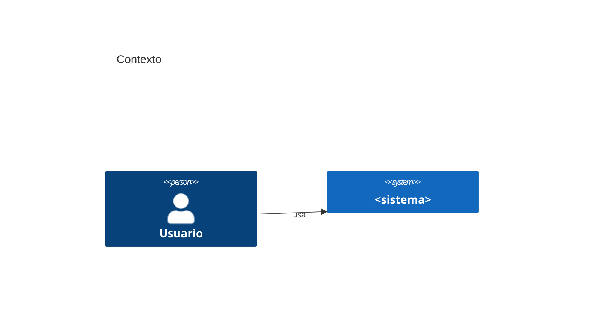

# Arquitectura — <misión>

> arc42 condensado. Lo desconocido se marca `TBD` y genera una pregunta; nunca se inventa.
> Sobre lo existente: cada sección describe primero el estado actual y luego el cambio.

## 1. Objetivos y restricciones

Objetivos de calidad (de `mission.md`, en orden): QG-1 … · QG-2 … · QG-3 …

### Escenarios de calidad

<!-- Uno o más por QG. Medibles: fuente · estímulo · entorno · artefacto · respuesta · medida. -->
- QS-1: fuente <…> · estímulo <…> · entorno <…> · artefacto <…> · respuesta <…> · medida <número y unidad> — serves: QG-1 — <por qué demuestra el objetivo>

### Restricciones

| Tipo | Restricción | Origen |
|---|---|---|
| Técnica | | |
| Organizativa | | |
| Legal | | |

## 2. Contexto (C4 nivel 1)



## 3. Contenedores (C4 nivel 2)

```mermaid
C4Container
  title Contenedores
```

| Contenedor | Tecnología | Responsabilidad |
|---|---|---|
| | | |

## 4. Componentes

<!-- Cada componente sirve a decisiones, historias o escenarios. -->
- C-1: <nombre> · <responsabilidad> — serves: ADR-1, US-01 — <cómo>

## 5. Datos

<Modelo de datos (Mermaid erDiagram), propiedad de los datos, retención.>

## 6. Contratos e interfaces

<Ruta del contrato (OpenAPI/AsyncAPI/GraphQL/JSON Schema) y reglas de versionado.>

## 7. Flujos clave

<Diagrama de secuencia Mermaid para los 2–3 flujos críticos.>

## 8. Decisiones transversales

| Tema | Decisión | ADR |
|---|---|---|
| Autenticación y autorización | | |
| Errores | | |
| Logging y observabilidad | | |
| Configuración y secretos | | |
| Seguridad (ver `docs/security/threat-model.md`) | | |

## 9. Despliegue

Resumen y enlace a `docs/ops/deploy-plan.md`.

## 10. Pruebas, documentación e interfaz

Enlaces a `docs/qa/test-strategy.md`, plan de documentación (tabla de docs-lead) y `docs/ux/ux-spec.md` (o `No aplica`).

## 11. Riesgos y deuda técnica

| Riesgo | Impacto | Mitigación |
|---|---|---|
| | | |

## 12. Trazabilidad

| QS / US | Componentes | ADR |
|---|---|---|
| | | |
