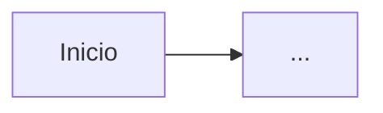

# Especificación UX/UI — <misión>

## Usuarios y tareas clave

| Usuario | Tarea clave | Historia | Dispositivo / contexto |
|---|---|---|---|
| | | US-… | |

## Flujos

<!-- Un diagrama Mermaid por tarea clave. -->

## Pantallas

| Pantalla | Tareas | Vacío | Cargando | Error | Éxito | Sin permiso |
|---|---|---|---|---|---|---|
| | | | | | | |

Prototipo navegable: `docs/ux/prototype/index.html`

## Sistema de diseño

- Tokens: `design-tokens.json` (color, tipografía, espaciado, radios, sombras)
- Componentes base:
- Breakpoints:
- Contraste y tamaño de objetivos: WCAG 2.2 AA

## Textos (microcopy)

| Situación | Texto |
|---|---|
| Error de validación | |
| Sin resultados | |
| Confirmación de acción destructiva | |
